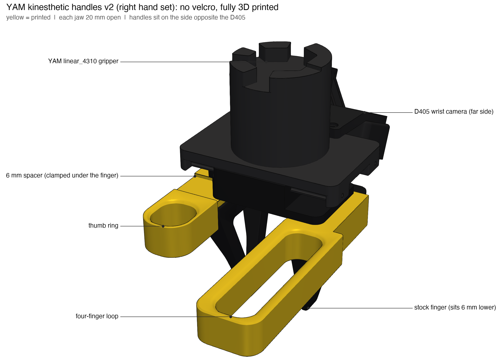
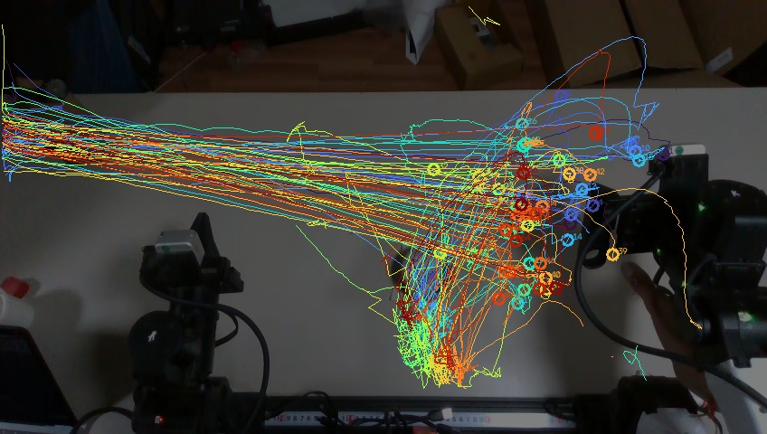
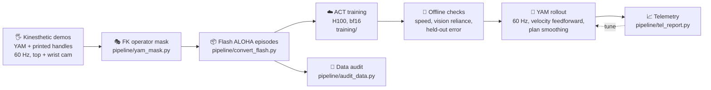
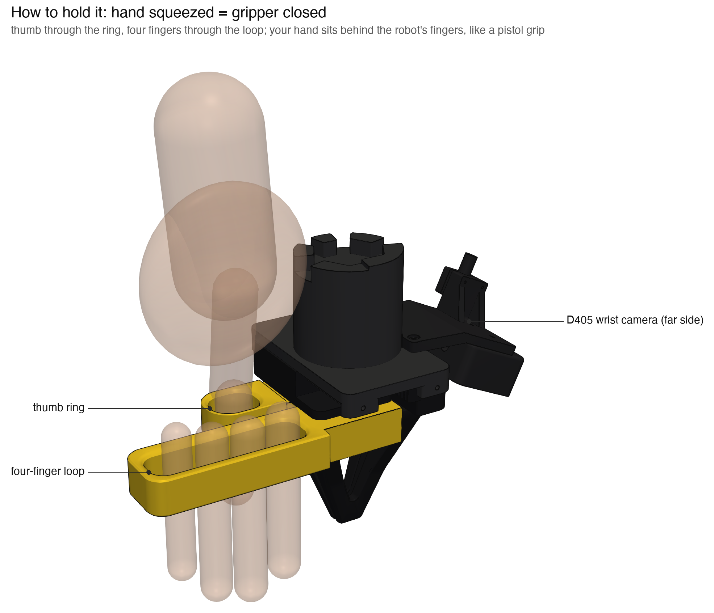
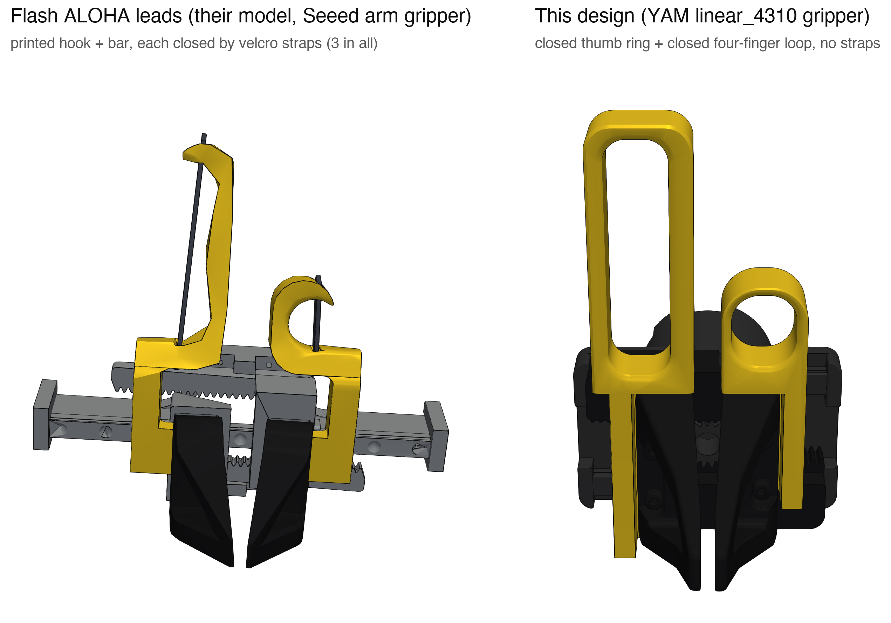

<div align="center">

# ⚡ YAM × Flash ALOHA

### Replicating *Flash ALOHA: Learning Fast and Precise Manipulation* on an i2rt YAM arm

**Kinesthetic handles · FK operator masking · ACT on cloud H100s · real-arm control tuning · a full data audit**

[](#)
[](#)
[-8A2BE2)](#)
[](#)
[](handles/)
[](#-status)
[](LICENSE)

 

<sub>Left: 3D-printed kinesthetic handles for the YAM gripper. Right: every ball roll in the dataset, tracked in the top camera (circles = where the arm caught it).</sub>

</div>

---

## 🎯 The task

> A person rolls a sponge ball across the table. The YAM arm intercepts it, grasps it, and drops it into a tape ring.

Demonstrations are recorded **kinesthetically**, the Flash ALOHA way: the operator holds handles mounted on the gripper and moves the real arm, at 60 Hz, with a top camera and a wrist camera. The policy is the Flash ALOHA recipe, a decoder-only **ACT** with per-camera ResNet18 backbones and 1 s action chunks, trained on a cloud H100.

## 🧭 Pipeline



## 📂 Repository

| Folder | What's inside |
|---|---|
| [`handles/`](handles/) | Parametric **CadQuery** handles for the YAM `linear_4310` gripper (v2: closed thumb ring + four-finger loop, no velcro). STEP, print-ready STL, renders, and an interference check over the full jaw stroke. |
| [`pipeline/`](pipeline/) | Everything between the robot and the model: forward kinematics, camera calibration, the **FK operator mask**, dataset conversion, the 2-frame dataset builder, offline evaluation, telemetry analysis and the **per-episode data audit**. See [`pipeline/README.md`](pipeline/README.md). |
| [`training/`](training/) | Task and training configs for the upstream Flash ALOHA trainer, plus the one-file cloud launcher (`setup` → `smoke` → `train`). |
| [`results/`](results/) | The per-episode audit table (59 episodes, ball track, grasp timing, regrasps). |
| [`docs/FINDINGS.md`](docs/FINDINGS.md) | The long version: every measurement, what it ruled in or out, and what to do next. |

## 🛠️ Hardware: kinesthetic handles

<div align="center">
 
</div>

- Fully 3D printed, **no supports, no straps**. Mounts with 4 × M4×16 per gripper on a 6 mm spacer.
- Squeezing your hand closes the gripper, and opening it opens the gripper. The layout follows Flash ALOHA's leads, measured from their own CAD.
- Checked against i2rt's meshes at 17 jaw openings: **no collisions**. Smallest clearance is 4.0 mm, handle to handle.

## 🎭 Operator masking

In kinesthetic data the operator's hands and arm are in every top-camera frame, but they're gone at deployment. As in the paper, we mask them analytically. The top camera's pose was solved from FK and hand-picked gripper pixels, and a polygon that follows the gripper is fitted to segmented operator pixels.

| | |
|---|---|
| Frames with the operator visible | **92 %** |
| Operator pixels left unmasked (median / p90) | **2 % / 14 %** |
| Unmasked operator area (median, % of image) | **0.09 %** |

The same mask, keyed by a SHA-256 of its JSON, runs at training and at inference, so a mismatched mask is refused.

## 🤖 Real-arm control tuning

Demo trajectories replayed open-loop on the real arm, measured against the demo:

| Setting | Lag behind demo | RMS error, j1–j6 (rad) | Worst (rad) | Wrist speed vs demo |
|---|---|---|---|---|
| Stock PD, lookahead 10 | arm 33–67 ms **early** (true lag ≈ 100–130 ms) | .015 – .035 | .126 | 75–80 % |
| **+ velocity feedforward, lookahead 3** | **≈ 0 ms** | **.009 – .018** | **.064** | **94–102 %** |
| + stiff shoulder/elbow (kp 130) | 0 ms on j2/j3 | .006 – .018 | .065 | — |

**Velocity feedforward** sends the plan's joint velocity alongside the position target, so the motor PD stops braking every motion. It cuts tracking error 2–4× and removes the lag. On top of that, **Hann smoothing** of each predicted chunk cuts command jerk 2–8× per joint, measured in a MuJoCo replica of the arm.

## 🔬 What we found

<table>
<tr><td>

**✅ Ruled out**
- Camera or colour mismatch: live tensors match training to 0.006
- Lighting: wrist brightness is identical live and in the demos
- Out-of-distribution rolls: live ball paths and speeds sit inside the demo distribution
- Arm tracking: fixed with feedforward
- "The policy ignores vision": swapping images changes the plan 0.13–0.16 rad

</td><td>

**❌ Root causes**
- **Memorization.** 0.5 s-ahead error is **0.011 rad** on training episodes vs **0.061 rad** held out (5.5×)
- **High-variance task, few demos.** Every roll is unique. Flash ALOHA randomizes objects along 15 cm of tape, and its ball is tossed by the robot's *own* arm
- **Mixed protocols.** Slow rolls (ep 0–15) and fast rolls (ep 16–58), 4–13.5 s episodes, gripper start anywhere from 0.0 to 0.99
- **Runner bugs (fixed):** the gripper was never reset between runs, and a squeeze offset ratcheted it shut

</td></tr>
</table>

The full story, with numbers for every claim, is in **[docs/FINDINGS.md](docs/FINDINGS.md)**.

## 🚀 Quick start

```bash
# 1. Upstream trainer (MIT): https://github.com/JohnYao93/flash-aloha
git clone https://github.com/JohnYao93/flash-aloha ~/flash-aloha
export FLASH_ALOHA_SRC=~/flash-aloha/src
export YAM_DATASET=~/datasets/yam-right-sponge        # LeRobot v3 recording

# 2. Mask + convert LeRobot episodes into Flash ALOHA raw episodes
python pipeline/convert_flash.py --help

# 3. Train on a cloud GPU (copies configs into the upstream repo, then runs)
bash training/train_cloud.sh setup && bash training/train_cloud.sh smoke && bash training/train_cloud.sh train

# 4. Check a checkpoint offline before it touches the robot
python pipeline/offline_eval.py --help
python pipeline/vision_reliance.py CKPT_DIR policy_step_100000_seed_0.ckpt EP_DIR [EP_DIR ...]

# 5. Audit a dataset
python pipeline/audit_data.py OUT_DIR
```

## 📍 Status

- [x] Kinesthetic handles designed, checked, printed and mounted
- [x] FK operator mask, calibrated and stress-tested
- [x] ACT trained on cloud H100s (1-frame and 2-frame variants)
- [x] Real-arm control: feedforward, gains, smoothing, gripper reset
- [x] Full data audit plus held-out generalization test
- [ ] **Real-arm runner code.** It lives on the robot PC and gets pushed when that box is back online
- [ ] Re-record with a low-variance protocol (fixed ramp, cued release, 3–4 s demos, 100+ episodes)
- [ ] Train with the paper's schedule (200k steps, batch 256), a held-out split and the proprio-noise curriculum
- [ ] Catching in the air with a repeatable launcher

## 🙏 Credits

- **Flash ALOHA** by John Hua Yao, Qi Wu, Yihuai Gao, Chelsea Finn and Zipeng Fu (Stanford). [Project](https://johnyao93.github.io/flash-aloha/) · [Code](https://github.com/JohnYao93/flash-aloha). This repo uses their trainer unmodified.
- **ACT** by Tony Z. Zhao et al., *Learning Fine-Grained Bimanual Manipulation with Low-Cost Hardware* (RSS 2023).
- **i2rt** for the YAM arm, its MuJoCo model and its Python SDK.

<div align="center"><sub>Built by <a href="https://github.com/sahilapage">@sahilapage</a> · MIT licensed</sub></div>
